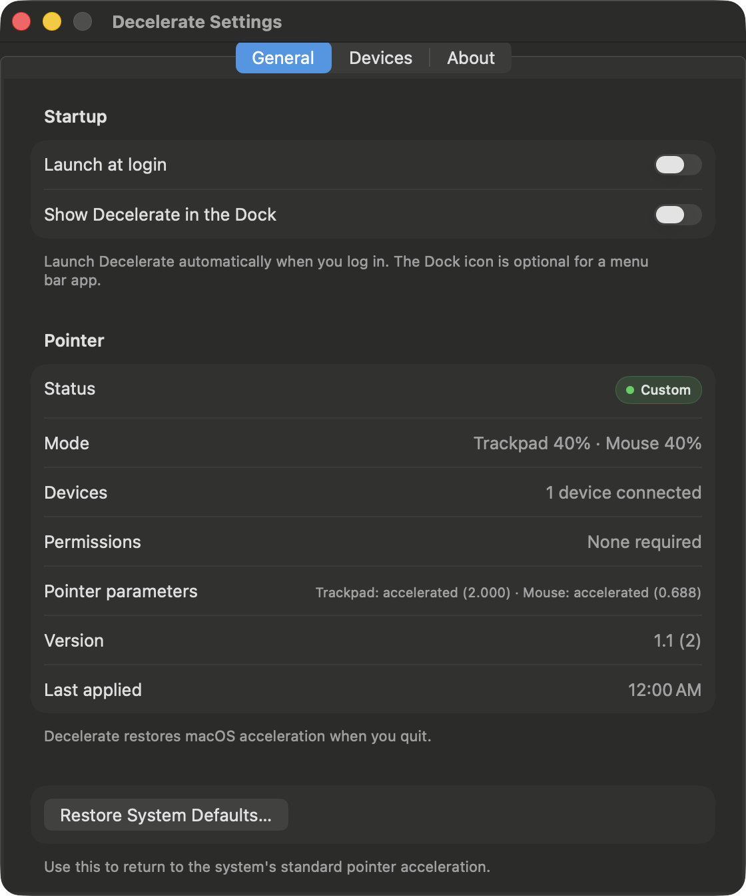
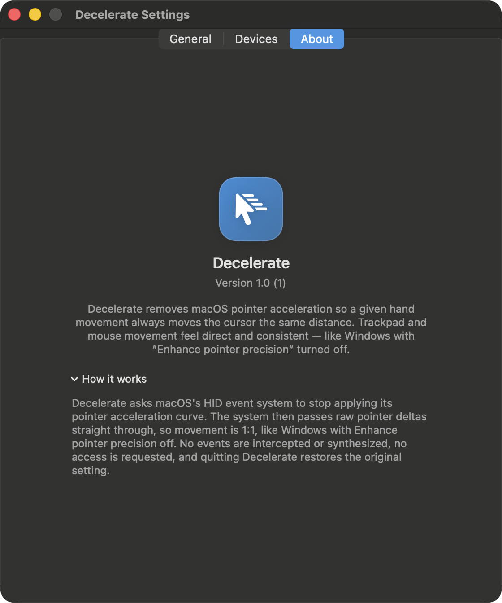

# Decelerate

A native macOS menu bar app that controls pointer acceleration for the
built-in trackpad and for mice. At 0% the pointer moves 1:1 with your hand, the
same as Windows with "Enhance pointer precision" turned off, and you can dial
acceleration back in from 0% to macOS's own curve. It ships at 50% acceleration
and 1.5× speed.

Decelerate does not intercept events, load kernel extensions, request
accessibility permissions, or add latency. It works inside macOS's HID event
system. It installs its own flat or blended acceleration curve there, or steps
out of the way at 100%.


## Why

macOS accelerates the pointer with a velocity curve. That suits a small
trackpad but makes precise pointing hard. The same physical movement travels
different distances depending on how fast you move. Windows users turn this off
with "Enhance pointer precision". macOS has no such switch. Decelerate adds one
for each device class:

- Trackpad: built-in trackpad and Magic Trackpad
- Mouse: USB, Bluetooth and receiver-based mice

## How it works

macOS keeps per-class pointer acceleration values in the HID system's
system-wide parameter dictionary (`HIDTrackpadAcceleration`,
`HIDMouseAcceleration`, …) as IOFixed 16.16 numbers, and the HID filter reads
them to select or scale each device's acceleration curve. On top of that,
`IOHIDPointerScrollFilter` caches per-service acceleration curves, including the
user curve override (`UserPointerAccelCurvesKey`) that Decelerate installs.

At 0% Decelerate installs a constant-gain user curve, so pointer deltas are
multiplied by the Speed setting and nothing else: exact linear movement. For
amounts between 0% and 100% it installs a blended curve derived from the
device's own macOS curve (gain(v) is interpolated toward 1.0). At 100% with
Speed at 1× it clears the override again so macOS's own curve applies. In every
case it writes the original positive parameter value back so acceleration stays
enabled for the curve to take effect.

Decelerate writes those parameters through the public IOHIDSystem parameter
connection (`IOServiceOpen(…, kIOHIDParamConnectType, …)` +
`IOHIDSetCFTypeParameter`), the same mechanism macOS uses for its own pointer
settings. It needs no root, no entitlements and no TCC permission, and it adds
zero overhead to the input path because nothing is intercepted.

Devices whose acceleration comes from a classic lookup table (most third-party
mice) do not expose curves; at intermediate amounts Decelerate uses the table's
built-in linear interpolation by scaling the acceleration index instead. Again,
nothing is intercepted.

Decelerate snapshots the original values before the first write and restores
them when the feature is switched off or the app quits, so macOS is never left
patched.

### Behaviour details

- Speed is Decelerate's own slider (0.5×–2×, with 1.5× in the middle; default
  1.5×). It scales the 1:1 movement directly, so it works with acceleration
  fully off. This is the Windows "pointer speed" control. macOS's own Tracking
  speed still sets the shape of the blended macOS curve at 100% and for
  intermediate amounts.
- For mice whose acceleration comes from the classic lookup table rather than a
  parametric curve, Decelerate scales the macOS acceleration index instead.
  That is the table's own linear interpolation between identity and full
  acceleration. The Speed control cannot be applied on that path, so for those
  mice it only takes effect at 0%, where the constant-gain curve is installed.
- Scroll acceleration is untouched. It is a separate HID parameter.
- Decelerate re-applies its state if macOS rewrites the parameter, for example
  when you move the Tracking speed slider, after sleep, and when a device is
  attached. Sleep/wake recreates the HID services (the built-in trackpad comes
  back with a new registry ID), so Decelerate re-creates its event-system
  connection and retries the apply for a few seconds until the devices are back.
  Without that, a stale connection makes macOS fall back to its own acceleration
  curve until the app is relaunched.
- Quitting restores macOS. The override exists only while Decelerate runs, and
  the menu bar icon shows that it is running.
- A crash cannot leave the Mac permanently patched: the original values are
  persisted, and the next launch re-applies or restores correctly. Even without
  a snapshot, values reset at logout/reboot.

## Requirements

- macOS 14 or later (developed and verified on macOS 26 Tahoe, Apple silicon)
- Xcode 15+ / Swift 5.9+ to build from source

## Build

```sh
./Scripts/build.sh            # Debug build → dist/Decelerate.app
./Scripts/build.sh Release    # Release build → dist/Decelerate.app
./Scripts/build.sh Release run
```

Or open `Decelerate.xcodeproj` in Xcode and run. The app is ad-hoc signed, so a
locally built copy launches without a Gatekeeper prompt.

## Install

```sh
./Scripts/install.sh          # builds Release, installs to ~/Applications, launches
```

Then enable **Launch at login** in Decelerate's settings so it starts with your
Mac. (macOS will list it under System Settings → General → Login Items.)

## Usage

Click the cursor icon in the menu bar:

- **Acceleration** per device class: 0% is no acceleration (exact 1:1), 100% is
  macOS's own curve, and intermediate values are a real blend. Default 50%.
- **Speed** per device class: 0.5×–2×, with 1.5× exactly in the middle of the
  slider. It scales the 1:1 movement, the Windows pointer-speed slider with
  "Enhance pointer precision" off. Default 1.5× (1× is geometry-true 1:1; raise
  it for faster movement).
- **Settings…** (⌘,) opens the full window: launch at login, Dock icon,
  connected devices, live HID parameter state, and **Restore System Defaults**.
- **Quit** (⌘Q) restores macOS acceleration.

| General settings | About settings |
|---|---|
|  |  |

## Uninstall

1. Quit Decelerate (this restores pointer acceleration).
2. Move `Decelerate.app` to the Trash.
3. Optionally remove preferences: `defaults delete com.decelerate.app`

## Development

| Path | Purpose |
|---|---|
| `Decelerate/App/` | App entry point, `AppState` observable model |
| `Decelerate/Core/` | HID pointer control, device scanner, preferences |
| `Decelerate/UI/` | SwiftUI menu bar panel and Settings window |
| `Notes/acceleration-research.md` | The verified research behind the mechanism (Apple source citations, evidence, permissions) |
| `Tools/Probe/` | Read-only/research probes used to verify the behaviour |
| `Scripts/` | Build, install, icon generation, window screenshots |

Debug launch flags (development only):

```sh
Decelerate.app/Contents/MacOS/Decelerate --preview-panel      # open the panel in a normal window
Decelerate.app/Contents/MacOS/Decelerate --preview-settings   # open Settings in a normal window
Decelerate.app/Contents/MacOS/Decelerate --quit-after 5       # quit cleanly after 5 s (QA)
Decelerate.app/Contents/MacOS/Decelerate --restore-defaults   # run Restore System Defaults after 2 s (QA)
```

Diagnostics while developing:

```sh
./Tools/Probe/bin/hidprobe get HIDTrackpadAcceleration   # read the live parameters
./Tools/Probe/filterlog.sh 10 10                          # WindowServer's acceleration decisions
```

The regression test for the UI is a build plus `--preview-*` screenshot; there
is no unit-test target yet.

## License

MIT. See [LICENSE](LICENSE).
