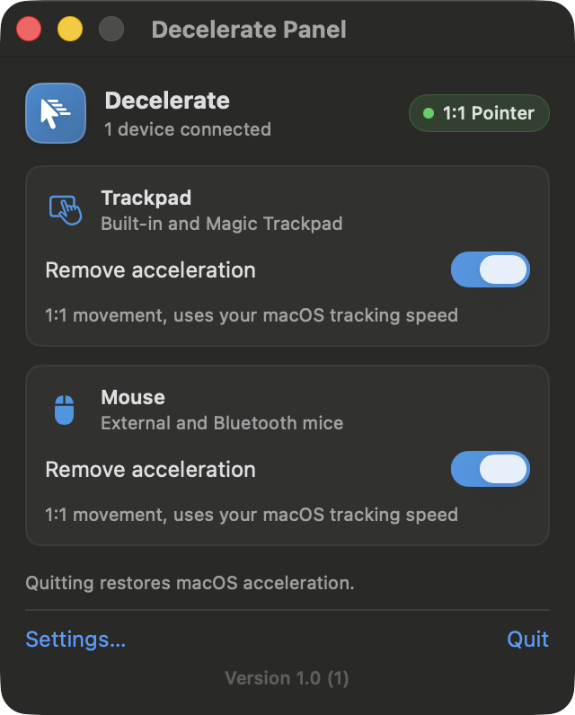

# Decelerate

A tiny native macOS menu bar app that **removes pointer acceleration** for the
built-in trackpad and for mice, so the pointer moves **1:1** with your hand —
the same feel as Windows with **“Enhance pointer precision” turned off**.

No event interception, no kernel extensions, no accessibility permissions, no
latency. Decelerate asks macOS's HID event system to stop applying its
acceleration curve; the system then passes raw pointer deltas straight through.



## Why

macOS accelerates the pointer with a velocity curve. It is handy on a small
trackpad and infuriating when you want precision: the same physical movement
travels different distances depending on how fast you move. Windows users turn
off “Enhance pointer precision” to get linear movement; macOS has no such
switch. Decelerate provides it, per device class:

- **Trackpad** — built-in trackpad and Magic Trackpad
- **Mouse** — USB, Bluetooth and receiver-based mice

## How it works

macOS keeps per-class pointer acceleration gains in the HID system's
system-wide parameter dictionary (`HIDTrackpadAcceleration`,
`HIDMouseAcceleration`, …) as IOFixed 16.16 numbers. A **negative** value is a
sentinel: Apple's `IOHIDPointerScrollFilter` returns before installing any
accelerator, and the raw HID deltas reach the pointer unchanged. That is exact
1:1 movement.

Decelerate writes that sentinel through the public IOHIDSystem parameter
connection (`IOServiceOpen(…, kIOHIDParamConnectType, …)` +
`IOHIDSetCFTypeParameter`) — the same mechanism macOS uses for its own pointer
settings. It needs no root, no entitlements and no TCC permission, and it adds
zero overhead to the input path because nothing is intercepted.

The original values are snapshotted before the first write and restored when
the feature is switched off or the app quits, so macOS is never left patched.

### Behaviour details

- **Speed** is whatever macOS “Tracking speed” is set to. In 1:1 mode the filter
  installs no curve, so the raw device gain applies; adjust it in System
  Settings → Trackpad/Mouse → Tracking speed if you want a different speed.
- **Scroll acceleration is untouched** — it is a separate HID parameter.
- **State is self-healing**: Decelerate re-applies if macOS rewrites the
  parameter (for example when you move the Tracking speed slider), after sleep,
  and when a device is attached.
- **Quitting restores acceleration.** Acceleration is removed only while
  Decelerate is running; the menu bar icon appears in the system menu bar when
  it is.
- A crash cannot leave the Mac permanently patched: the original values are
  persisted, and the next launch re-applies or restores correctly. Even without
  a snapshot, values reset at logout/reboot.

## Requirements

- macOS 14 or later (developed and verified on macOS 26 Tahoe, Apple silicon)
- Xcode 15+ / Swift 5.9+ to build from source

## Build

```sh
./Scripts/build.sh            # Debug build → dist/Decelerate.app
./Scripts/build.sh Release    # Release build → dist/Decelerate.app
./Scripts/build.sh Release run
```

Or open `Decelerate.xcodeproj` in Xcode and run. The app is ad-hoc signed, so a
locally built copy launches without a Gatekeeper prompt.

## Install

```sh
./Scripts/install.sh          # builds Release, installs to ~/Applications, launches
```

Then enable **Launch at login** in Decelerate's settings so it starts with your
Mac. (macOS will list it under System Settings → General → Login Items.)

## Usage

Click the cursor icon in the menu bar:

- Toggle **Remove acceleration** for the trackpad and/or the mouse.
- **Settings…** (⌘,) opens the full window: launch at login, Dock icon,
  connected devices, live HID parameter state, and **Restore System Defaults**.
- **Quit** (⌘Q) restores macOS acceleration.

## Uninstall

1. Quit Decelerate (this restores pointer acceleration).
2. Move `Decelerate.app` to the Trash.
3. Optionally remove preferences: `defaults delete com.decelerate.app`

## Development

| Path | Purpose |
|---|---|
| `Decelerate/App/` | App entry point, `AppState` observable model |
| `Decelerate/Core/` | HID pointer control, device scanner, preferences |
| `Decelerate/UI/` | SwiftUI menu bar panel and Settings window |
| `Notes/acceleration-research.md` | The verified research behind the mechanism (Apple source citations, evidence, permissions) |
| `Tools/Probe/` | Read-only/research probes used to verify the behaviour |
| `Scripts/` | Build, install, icon generation, window screenshots |

Debug launch flags (development only):

```sh
Decelerate.app/Contents/MacOS/Decelerate --preview-panel      # open the panel in a normal window
Decelerate.app/Contents/MacOS/Decelerate --preview-settings   # open Settings in a normal window
Decelerate.app/Contents/MacOS/Decelerate --quit-after 5       # quit cleanly after 5 s (QA)
```

Diagnostics while developing:

```sh
./Tools/Probe/bin/hidprobe get HIDTrackpadAcceleration   # read the live parameters
./Tools/Probe/filterlog.sh 10 10                          # WindowServer's acceleration decisions
```

The regression test for the UI is a build plus `--preview-*` screenshot; there
is no unit-test target yet.

## License

MIT — see [LICENSE](LICENSE).
